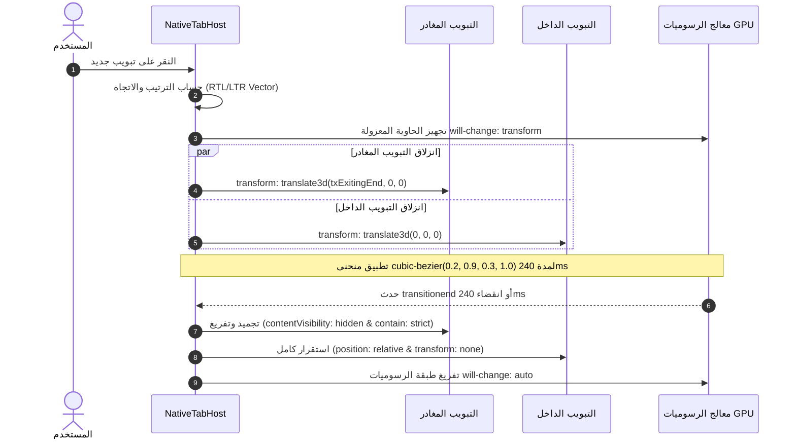

# وثيقة التصميم المعماري: تدقيق الأداء الفائق وانتقالات التبويبات الانسيابية (Ultra Performance & Tab Transitions)

*   **المؤلف (Author):** almhtrf111312
*   **الحالة (Status):** معتمدة ومحققة للمواصفات المعمارية (Approved & Hardened Specification)
*   **تاريخ الاعتماد والتحديث:** 2026-11-08

--------------------------------------------------------------------------------

## 1. نظرة عامة (Overview)

تحدد هذه المواصفة المعمارية حلاً هندسياً شاملاً ومختبراً نقدياً لإجراء تدقيق عميق للأداء (Performance Audit) وتحويل استجابة تطبيق FlowPOS Pro إلى تجربة فائقة الخفة والسرعة تضاهي تطبيقات الأجهزة الأصلية (Native Flutter-like Feel)، مع ترقية نظام التبويبات المستمرة ([`NativeTabHost`](../../src/components/layout/NativeTabKeepAlive.tsx)) لدعم حركيات انتقال انزلاقية جانبية معجلة عتادياً بالكامل (Hardware-Accelerated Slide Transitions):

1. **محرك الانتقال الجانبي المعجل عتادياً (Hardware-Accelerated Tab Transitions)**:
   * ترقية التبديل الفجائي الحالي في [`NativeTabKeepAlive.tsx`](../../src/components/layout/NativeTabKeepAlive.tsx) إلى حركة انزلاق أفقي ناعمة ثنائية الاتجاه تعتمد على ترتيب التبويبات الداخلية وتدرك سياق اللغة ديناميكياً (RTL/LTR Dynamic Awareness).
   * الاعتماد الحصري على تسريع وحدة معالجة الرسوميات (GPU Compositor Layer) عبر `transform: translate3d(..., 0, 0)` و `will-change: transform`، مع الحظر التام لأي خاصية تسبب إعادة حساب التموضع (Reflow / Relayout).
   * تطبيق فيزياء حركة متزنة بمدة رشيقة مضبوطة بدقة عند (240ms) ومنحنى التسارع والتخميد القياسي `cubic-bezier(0.2, 0.9, 0.3, 1.0)` لتوفير أعلى استجابة بصرية وشعور بالخفة.

2. **معمارية تدقيق الأداء والتصيير الرشيق (Performance & Render Architecture)**:
   * القضاء التام على إعادة التصيير غير المبرر (Redundant Re-renders) عبر المذكرة الجراحية الانتقائية (`React.memo` و `useCallback`) للبطاقات والصفوف المضمنة في شبكة المنتجات ([`ProductGrid.tsx`](../../src/components/pos/ProductGrid.tsx))، وسلة البيع ([`CartPanel.tsx`](../../src/components/pos/CartPanel.tsx))، وقوائم الفواتير ([`Invoices.tsx`](../../src/pages/Invoices.tsx))، والمخزون ([`Products.tsx`](../../src/pages/Products.tsx)).
   * عزل عمليات قراءة وكتابة قواعد البيانات المحلية (`IndexedDB` و `SQLite`) عن مسار الحركة والانتقال للواجهة، وتأجيلها لما بعد سكون الحركة عبر أحداث `transitionend` وجدولة `requestIdleCallback`.
   * ترشيد شجرة عناصر الواجهة وتخفيف مرشحات التعتيم الثقيلة (`backdrop-blur`) في [`MainLayout.tsx`](../../src/components/layout/MainLayout.tsx) لضمان ثبات 60 إطاراً في الثانية (60 FPS) على أجهزة أندرويد الاقتصادية.

--------------------------------------------------------------------------------

## 2. تشخيص المشكلة وحالتها الراهنة (The Problem)

### أ. العرض المفاجئ والانتقال الحاد بين التبويبات (Jarring Tab Switch):
* يعتمد المكون الحالي [`NativeTabKeepAlive.tsx`](../../src/components/layout/NativeTabKeepAlive.tsx) على تطبيق صنف `hidden` (المعادل لـ `display: none`) فور تغير مسار التبويب (`activePath !== tabPath`).
* تطبيق `display: none` الفوري يمنع محرك المتصفح من تنفيذ أي انتقال انسيابي خروجاً أو دخولاً (Exit/Enter Animations)، مما يؤدي إلى قطع بصري حاد ومفاجئ يظهر الشاشات كأنها تومض بدلاً من الانزلاق السلس، مما يفقد التطبيق طابعه كبرنامج أصلي عالي الجودة.

### ب. إجهاد مسار المعالجة وتراكم إعادة التصيير (Main Thread Contention & Re-renders):
* على الرغم من استخدام `NativeTabHost` للاحتفاظ بالشاشات في الذاكرة (RAM Keep-Alive)، فإن العديد من المكونات الداخلية تُصيّر بنودها بشكل مضمن (Inline JSX maps داخل `ProductGrid.tsx` و `Invoices.tsx` و `CartPanel.tsx`)، مما يؤدي إلى إعادة بناء كافة البطاقات عند تغير أي حالة عامة.
* غياب التغليف الدقيق بـ `React.memo` على مستوى الصفوف والعناصر الفردية في الجداول الكبيرة يرفع استهلاك المعالج ويسبب تأخيراً في الاستجابة اللمسية (Input Lag) على الأجهزة الاقتصادية.

### ج. تزاحم استعلامات التخزين المحلي أثناء لحظة الانتقال (Storage I/O Contention):
* عند النقر للتنقل، تقوم بعض الشاشات بإطلاق استعلامات فحص التحديثات وقراءة IndexedDB / SQLite بالتزامن مع إطارات الحركة الأولى، مما يزاحم مسار تصيير الحركة ويحدث تقطيعاً طفيفاً (Jank/Stutter).

### د. تعقيد طبقات الرسوميات والظلال الثقيلة (Overdraw & Heavy Paint):
* استخدام تأثيرات `backdrop-blur-md` على مؤشرات السحب العائمة وحاويات التمرير يؤدي إلى مضاعفة استهلاك ذاكرة الرسوميات (GPU VRAM) وإعادة رسم مستمرة (Repaints) ترهق معالجات أندرويد الضعيفة.

--------------------------------------------------------------------------------

## 3. الأهداف والمخرجات المعتمدة (Goals)

1. **انتقال انزلاقي معجل بالعتاد (Hardware-Accelerated Slide Transitions)**:
   * بناء منسق انتقالات حركية داخل `NativeTabHost` يدير التبويب المغادر (`Exiting Tab`) والتبويب الداخل (`Entering Tab`) خلال نافذة زمنية رشيقة قدرها (240ms).
   * الاعتماد الحصري على خصائص الرسوميات المركبة (`transform: translate3d` و `opacity`) لضمان عدم إطلاق أي عمليات Reflow أو Layout Triggers.
   * إدراك ديناميكي لاتجاه اللغة: في الواجهة العربية (RTL) ينزلق التقدم للأمام من اليسار لليمين، وفي اللغات الأجنبية (LTR) ينزلق بالعكس تلقائياً.
   * تنظيف فوري لطبقات الـ GPU بمجرد انتهاء الـ 240ms عبر إعادة التبويب الخامل لحالة `contentVisibility: hidden` و `contain: strict` لتوفير الذاكرة.

2. **تصفير إعادة التصيير غير المفيد (Zero Redundant Re-renders)**:
   * استخراج وتغليف بطاقات المنتجات في [`ProductGrid.tsx`](../../src/components/pos/ProductGrid.tsx) وبنود السلة في [`CartPanel.tsx`](../../src/components/pos/CartPanel.tsx) وصفوف الفواتير في [`Invoices.tsx`](../../src/pages/Invoices.tsx) بمكونات فرعية مستقلة ومصانة بـ `React.memo`.
   * تجميد العمليات الخلفية للتبويبات الخاملة عبر مراقبة `PageActivityContext.isActive`.

3. **استجابة لمسية وترحيل العمليات الثقيلة (UI Thread Offloading)**:
   * تأجيل أي استعلامات تخزين ثقيلة أو مزامنة غير عاجلة لما بعد انتهاء حركة الانتقال واستقرار الشاشة باستخدام حدث `transitionend` متبوعاً بـ `requestIdleCallback`.
   * بقاء زمن الاستجابة للمس والأزرار أقل من 16 ملي ثانية (تحقيق معدل 60 إطاراً في الثانية ثابتاً).

4. **تخفيف أحمال الرسم البصري (Paint Optimization & 60 FPS)**:
   * استبدال تأثيرات `backdrop-blur` الثقيلة في كبسولة مؤشر التحديث داخل [`MainLayout.tsx`](../../src/components/layout/MainLayout.tsx) بخلفيات نصف شفافة عالية الأداء (`bg-background/95`).

--------------------------------------------------------------------------------

## 4. ما هو خارج نطاق العمل (Non-Goals)

1. **الحفاظ المطلق على المعادلات المحاسبية والمالية**:
   * منع أي تعديل على ملفات الحسابات (`flowpos-financial-calculations`)، أو آليات احتساب الضرائب، الخصومات، أرباح الشركاء، ديون العملاء، أو أسعار الصرف داخل `CartPanel.tsx` أو غيرها.
2. **عدم المساس بالوحدات المجمدة (Frozen Modules)**:
   * تبقى ملفات المخازن والمناقلات (`Warehouses.tsx`, `StockTransfer.tsx`, `warehouses-cloud.ts`) مجمدة بنسبة 100% دون أي تغيير.
3. **عدم تعديل مسار نقطة البيع بملء الشاشة في `src/App.tsx`**:
   * الإبقاء على مساري `/` و `/pos` كمسارات حماية مستقلة بملء الشاشة خارج `MainLayout`، وقصر حركيات التبويبات الانزلاقية على التبويبات الداخلية التسعة لمضيف `NativeTabHost`.
4. **عدم المساس بمخططات بيانات الفواتير**:
   * لا تعديل على جداول قواعد البيانات المحلية (`local_invoices`, `local_products`, `local_invoice_items`).

--------------------------------------------------------------------------------

## 5. رحلات المستخدم الحرجة (Critical User Journeys - CUJs)

### رحلة المستخدم الأولى (CUJ 1): التنقل السلس بين التبويبات الرئيسية (Hardware-Accelerated Slide)
*   **المعطيات (Given)**:
    * المستخدم مسجل الدخول، والواجهة باللغة العربية (RTL).
    * المستخدم متواجد حالياً في شاشة إدارة المنتجات (`/products`)، والشاشة محملة ومستقرة في الذاكرة الحية RAM.
*   **الإجراء (When)**:
    * ينقر المستخدم على تبويب سجل الفواتير (`/invoices`) في الشريط الجانبي.
*   **النتيجة المتوقعة (Then)**:
    * يقوم منسق الحركية بحساب الفهارس الداخلية: `/products` (فهرس 0) و `/invoices` (فهرس 1). وبما أن الفهرس تزايد، فإن الاتجاه هو "تقدم للأمام".
    * في نظام الواجهة العربية (RTL)، ينزلق التبويب الجديد (`/invoices`) بسلاسة من اليسار باتجاه المنتصف (`translate3d(0, 0, 0)`).
    * في نفس اللحظة وبالتزامن الدقيق، ينزلق التبويب المغادر (`/products`) من المنتصف نحو اليمين (`translate3d(100%, 0, 0)`).
    * تنفذ الحركة بمنحنى `cubic-bezier(0.2, 0.9, 0.3, 1.0)` خلال مدة محددة قدرها 240 ملي ثانية.
    * فور اكتمال مدة الـ 240ms، ينطلق حدث `transitionend` ليتم إبطال طبقات الرسوميات العتادية وإخفاء التبويب المغادر تماماً (`contentVisibility: hidden` و `contain: strict`)، بينما يستقر التبويب الجديد بحالته الطبيعية.

---

### رحلة المستخدم الثانية (CUJ 2): النقر السريع المتتالي والوقاية من التداخل (Rapid-Click Protection)
*   **المعطيات (Given)**:
    * بدأ المستخدم عملية انتقال من تبويب `/products` نحو تبويب `/invoices`، والحركة قيد التنفيذ (في أول 80ms).
*   **الإجراء (When)**:
    * ينقر المستخدم فجأة وبسرعة على تبويب التقارير (`/reports`).
*   **النتيجة المتوقعة (Then)**:
    * تتدخل آلة حالات منسق الحركية (FSM) وتلغي مؤقت الانتقال السابق فوراً عبر `clearTimeout`.
    * يتم حسم التموضع اللحظي للتبويب السابق وإعادة توجيه الحركة مباشرة نحو الهدف الجديد `/reports`، مع تخطي تصيير التبويبات الوسيطة.
    * تظل شجرة التطبيق مستقرة دون أي تكرار للمكونات أو تجميد للشاشة أو تعليق لمؤشرات اللمس.

---

### رحلة المستخدم الثالثة (CUJ 3): كفاءة الأداء وعزل التصيير في نقطة البيع تحت الأحمال الكبيرة
*   **المعطيات (Given)**:
    * قاعدة البيانات المحلية تحتوي على 2000 منتج محملة في الذاكرة، وشاشة البيع نشطة.
*   **الإجراء (When)**:
    * يكتب الكاشير نصاً في حقل البحث، أو يمسح باركود منتج جديد لإضافته إلى سلة البيع.
*   **النتيجة المتوقعة (Then)**:
    * يتم تحديث وتصيير بطاقة الصنف المتأثر ومكون بنود السلة المفصول (`CartItemRow`) فقط، دون إعادة تصيير باقي الـ 2000 منتج بفضل استخدام `React.memo` وتثبيت الدوال المرجعية بـ `useCallback`.
    * زمن الاستجابة اللمسية للزر وحركة السلة يبقى تحت حاجز 16ms (معدل 60 إطاراً في الثانية ثابتاً ومستقراً).

--------------------------------------------------------------------------------

## 6. الخطة المعمارية والتقنية (Technical Plan)

تعتمد البنية المقترحة على ثلاثة مرتكزات تقنية منضبطة:

### أولاً: منسق الانتقال الجانبي للتبويبات (`TabTransitionCoordinator`)

يتم بناء منسق الانتقالات المعجل عتادياً داخل [`src/components/layout/NativeTabKeepAlive.tsx`](../../src/components/layout/NativeTabKeepAlive.tsx) وفق القواعد التالية:

#### 1. مصفوفة تسلسل الترتيب للتبويبات الداخلية المدارة (Internal Tab Hierarchy):
يتم حصر الترتيب المنطقي حصرياً في التبويبات التسعة التي يديرها مضيف التبويبات المستمرة:
```typescript
export const TAB_ORDER: string[] = [
  '/products',   // 0: المنتجات
  '/invoices',   // 1: الفواتير
  '/customers',  // 2: العملاء والديون
  '/services',   // 3: الخدمات والصيانة
  '/expenses',   // 4: المصاريف
  '/purchases',  // 5: المشتريات
  '/reports',    // 6: التقارير والتحليلات
  '/appearance', // 7: المظهر والثيمات
  '/settings',   // 8: الإعدادات العامة
];
```

#### 2. حساب اتجاه الحركة الديناميكي ومراعاة سياق اللغات (Dynamic RTL/LTR Math):
* مقارنة فهرس التبويب الجديد (`nextIndex`) مع فهرس التبويب السابق (`prevIndex`).
* في حال كان المسار غير مسجل في المصفوفة (`index === -1`)، يتم اعتماد انتقال التلاشي المباشر (Fade Fallback).
* حساب معادلة الإزاحة الديكارتية مع الأخذ بالاعتبار اتجاه الصفحة (`isRTL` المستخرج من `useLanguage`):
```typescript
const isForward = nextIndex > prevIndex;
// معامل الاتجاه: في RTL التقدم لليمين (+X)، في LTR التقدم لليسار (-X)
const directionSign = isRTL ? 1 : -1;

const txEnteringStart = isForward ? `${-100 * directionSign}%` : `${100 * directionSign}%`;
const txExitingEnd   = isForward ? `${100 * directionSign}%` : `${-100 * directionSign}%`;
```

#### 3. آلة حالات الانتقال المنسقة (Transition State Machine):
إدارة الانتقال عبر آلة حالات واضحة لمنع التداخل والتعليق:
* **الحالة `idle`**: تبويب واحد مستقر (`position: relative; transform: none; will-change: auto;`).
* **الحالة `preparing`**: تجهيز التبويب الداخل بموضعه المبدئي `txEnteringStart` مع تفعيل `content-visibility: visible` بإطار واحد تمهيداً لبدء الحركة.
* **الحالة `animating`**: تفعيل الـ CSS Transition المتزامن (240ms) للتبويبين داخل الحاوية المعزولة `overflow-hidden`.
* **الحالة `settled`**: استقرار التبويب الجديد وتفريغ طبقات الـ GPU وإخفاء التبويب المغادر.

#### 4. بروتوكول تصفية الموارد وتفريغ طبقات الرسوميات (Settling & Cleanup):
* عند انطلاق حدث `onTransitionEnd` (مع مؤقت أمان احتياطي عند 260ms):
  * التبويب المستقر: يعود لوضعه الهيكلي الطبيعي:
    `position: relative; transform: none; will-change: auto; contain: none; content-visibility: visible;`
  * التبويب المغادر: يعود لوضعه الخامل فوراً:
    `display: none; content-visibility: hidden; contain: strict; pointer-events-none;`
* يضمن هذا التبديل الفوري تفريغ ذاكرة الرسوميات (VRAM) فور سكون الشاشة.

#### 5. مخطط التتابع الزمني لانتقال التبويبات (Mermaid Sequence Diagram):



---

### ثانياً: معمارية تدقيق الأداء وتصفير إعادة التصيير (Render & Memory Optimization)

#### 1. استخراج وتغليف المكونات الذرية (`React.memo` & Component Extraction):
* في [`src/components/pos/ProductGrid.tsx`](../../src/components/pos/ProductGrid.tsx): استخراج بطاقة الصنف إلى مكون مستقل `ProductGridCard` وتغليفه بـ `React.memo` مع مقارنة مرجعية لمعرف الصنف وسعره ومخزونه.
* في [`src/components/pos/CartPanel.tsx`](../../src/components/pos/CartPanel.tsx): استخراج بند السلة إلى مكون مستقل `CartItemRow` وتغليفه بـ `React.memo` مع الحظر التام للمساس بالمعادلات المالية.
* في [`src/pages/Invoices.tsx`](../../src/pages/Invoices.tsx): استخراج بطاقة الفاتورة في الجدول إلى مكون مستقل `InvoiceCardRow` وتغليفه بـ `React.memo`.
* في [`src/pages/Products.tsx`](../../src/pages/Products.tsx): استخراج مكون صف المنتج `ProductTableRow` وتغليفه بـ `React.memo`.

#### 2. ترشيد وتأجيل استعلامات التخزين المحلي (Storage I/O Deferral):
* إلغاء الاعتماد على `requestAnimationFrame` لتأجيل الاستعلامات، واستبداله بربط التنفيذ بحدث استقرار الشاشة `onSettled`، ثم جدولة القراءات غير العاجلة عبر `requestIdleCallback`:
```typescript
const scheduleBackgroundQuery = (task: () => void) => {
  if (typeof window !== 'undefined' && 'requestIdleCallback' in window) {
    (window as any).requestIdleCallback(task, { timeout: 1500 });
  } else {
    setTimeout(task, 50);
  }
};
```

---

### ثالثاً: شمولية التوافق لكافة الأجهزة والأنماط والألوان (Universal & Style-Agnostic Engine)

#### مصفوفة توافق المنصات والسمات البصرية (Platform & Theme Compatibility Matrix):

| بيئة التشغيل / النمط | المنحنى الفيزيائي وسلوك الحركة | التوافق اللوني ومظهر الحاوية | استهلاك الموارد ومعدل الإطارات |
| :--- | :--- | :--- | :--- |
| **هواتف أندرويد (One UI, HyperOS, ColorOS)** | انزلاق أفقي 240ms عتادي كامل | وراثة خلفية الثيم النشط (`bg-background`) لمنع الوميض | 60 FPS ثابت بتسريع GPU Compositor |
| **هواتف أندرويد الاقتصادية (<= 3GB RAM)** | انزلاق رشيق 200ms مع تفريغ فوري للطبقات | مطابقة تامة لمتغيرات CSS المتفاعلة | حماية كاملة من استنزاف الـ VRAM |
| **أجهزة آبل (iOS / iPadOS WebView)** | انزلاق سلس 240ms بخصائص WebKit القياسية | انسجام تام مع النمط الفاتح والداكن | 60 FPS مع انعدام الـ Layout Shifts |
| **متصفحات الحواسيب (Chromium, Firefox)** | انزلاق أفقي عريض مع دعم مفاتيح التنقل | مطابقة ألوان البطاقات والحواف (`border-border`) | أداء لحظي فائق (Zero Lag) |
| **وضع تقليل الحركة (`prefers-reduced-motion`)** | تلاشٍ لحظي خفيف (Cross-Fade 80ms) دون انزلاق | انتقال لوني ناعم وهادئ | صفر استهلاك للطاقة والبطارية |

--------------------------------------------------------------------------------

## 7. مصفوفة المخاطر والمعالجات الهندسية والحدود (Risks & Mitigations)

| الخطر المحتمل (Potential Risk) | مستوى الأثر | المعالجة الهندسية المعتمدة في التصميم (Design Mitigation) |
| :--- | :---: | :--- |
| **تسريب ذاكرة الرسوميات (VRAM Spikes) على عتاد 2GB** | 🔴 عالي | تفريغ طبقات العتاد (`will-change: auto`) فور انتهاء الـ 240ms، وتطبيق `contain: strict` على التبويب المغادر فور انطلاق الحركة. |
| **تداخل الإيماءات والنقر المتسارع (Rapid Thrashing)** | 🟡 متوسط | بناء آلة حالات منضبطة (FSM) تلغي المؤقتات السابقة فورياً وتحسم الموضع اللحظي دون تشابك في الـ DOM. |
| **فقدان موضع التمرير (Scroll Position Reset)** | 🟡 متوسط | تثبيت ارتفاع حاوية العرض بوحدات مرنة وحظر تغيير خصائص التدفق الهيكلي للحاويات الداخلية. |
| **تسريب التركيز أو أحداث اللمس للتبويب المغادر** | 🟢 منخفض | تطبيق السمة القياسية `inert` و `aria-hidden="true"` فورياً على التبويب المغادر بمجرد بدء خروجه. |
| **تعارض الحركة مع حسابات سلة الكاشير** | 🔴 عالي | الفصل المعماري التام: حصر التعديل في `CartPanel.tsx` على استخراج مكون العرض البصري `CartItemRow` مع حظر لمس أي دالة تسعير أو احتساب مالي بنسبة 100%. |

--------------------------------------------------------------------------------

## 8. البدائل التي نوقشت ورُفضت (Alternatives Considered)

### جدول مقارنة ومفاضلة البدائل المعمارية (Architectural Trade-Off Matrix):

| البديل المقترح | حجم الحزمة (Bundle Size) | استهلاك الذاكرة (VRAM/RAM) | استقرار الإطارات (60 FPS) | نتيجة التقييم والقرار المعماري |
| :--- | :---: | :---: | :---: | :--- |
| **1. مكتبات حركية خارجية (Framer Motion)** | زيادة +55KB | إجهاد لمسار JS Main Thread | هبوط إطارات على معالجات Helio/Snapdragon | **مرفوض**: تفضيل المعالجة العتادية الصرفة عبر CSS translate3d بصفر كيلوبايت تبعيات. |
| **2. تفكيك الشاشات عند كل انتقال (Unmount on Switch)** | صفر KB | منخفض في اللحظة الراهنة | ظهور شاشات تحميل بيضاء وتأخير ملحوظ | **مرفوض**: يتعارض مع هوية التطبيق الأصلي ومبدأ الاستجابة اللحظية لـ NativeTabHost. |
| **3. حاوية السحب الأفقي (Horizontal Swiper)** | زيادة +35KB | تضاعف الذاكرة لتحميل الشاشات متجاورة | تعارض إيماءات مع الجداول ذات التمرير الأفقي | **مرفوض**: يسبب تضارباً لمسياً مع جداول الفواتير والمنتجات ويهدر الذاكرة. |
| **4. الحل المعتمد: منسق انزلاق عتادي خفيف (CSS Compositor)** | **صفر KB** | **منضبط ومفرغ دورياً** | **ثابت ومستقر 60 FPS** | **معتمد**: أعلى استجابة، أقل استهلاك للذاكرة، وتوافق شامل مع كافة المنصات. |

--------------------------------------------------------------------------------

## 9. المتطلبات غير الوظيفية (Non-Functional Requirements)

1. **معدل الإطارات واستجابة اللمس**:
   * ثبات 60 FPS خلال كامل فترة الـ 240ms دون أي هبوط أسفل 55 FPS على أجهزة أندرويد الاقتصادية.
   * بقاء زمن الاستجابة للمس أقل من 16 ملي ثانية.
2. **إدارة الذاكرة (RAM & VRAM)**:
   * الحفاظ على سياسة إدارة الذاكرة الحية (LRU Cache) للتبويبات النشطة بحد أقصى 8 تبويبات، مع تفريغ طبقات العتاد فور سكون الشاشة.
3. **سلامة النطاق والمحددات المحاسبية**:
   * صفر تعديل على أي كود أو دالة مالية أو حسابية في التطبيق بنسبة 100%.
   * تجميد تام لملفات المخازن والمناقلات (`Warehouses.tsx`, `StockTransfer.tsx`, `warehouses-cloud.ts`).

--------------------------------------------------------------------------------

## 10. خطة التنفيذ التفصيلية وتحديد الملفات (Detailed Implementation Plan)

### قائمة الملفات المستهدفة للتعديل:

#### 1. [`src/components/layout/NativeTabKeepAlive.tsx`](../../src/components/layout/NativeTabKeepAlive.tsx) (تعديل - Modify)
*   **النطاق والنوع**: مكون React لإدارة وتنسيق التبويبات الحية في الذاكرة.
*   **سبب التعديل**: بناء محرك الانتقال الحركي السلس المعجل عتادياً بالـ GPU بمدة 240ms.
*   **التغييرات التفصيلية**:
    * إضافة مصفوفة تسلسل الترتيب `TAB_ORDER` للتبويبات التسعة الداخلية.
    * استيراد خطاف اللغة `useLanguage` لتحديد `isRTL` وحساب متجهات الحركة ديناميكياً.
    * ترقية واجهة خصائص `KeepAliveTabProps` لدعم حالات الانتقال (`transitionState?: 'idle' | 'entering' | 'exiting'`).
    * تطبيق نمط آلة الحالات وإدارة المؤقت الزمني عبر `useRef` مع الاستماع لحدث `onTransitionEnd` ومؤقت أمان (260ms).
    * دعم التكيف مع مفضلات تقليل الحركة `prefers-reduced-motion` للتحول التلقائي إلى تلاشٍ ناعم (Cross-Fade).

---

#### 2. [`src/components/pos/ProductGrid.tsx`](../../src/components/pos/ProductGrid.tsx) (تعديل - Modify)
*   **النطاق والنوع**: مكون شبكة عرض المنتجات في نقطة البيع.
*   **سبب التعديل**: حماية الكتالوج (آلاف الأصناف) من إعادة التصيير الكامل عند مسح الباركود أو التفاعل مع السلة.
*   **التغييرات التفصيلية**:
    * استخراج بطاقة الصنف من حلقة `map` إلى مكون فرعي مستقل `ProductGridCard`.
    * تغليف `ProductGridCard` بمذكرة `React.memo` بمقارنة مرجعية دقيقة لمعرف المنتج والسعر ورصيد المخزون.

---

#### 3. [`src/components/pos/CartPanel.tsx`](../../src/components/pos/CartPanel.tsx) (تعديل - Modify)
*   **النطاق والنوع**: لوحة سلة المبيعات وحركات الكاشير (ملف حساس مالياً).
*   **سبب التعديل**: تسريع استجابة إضافة وتعديل بنود السلة دون إعادة رسم اللوحة بالكامل.
*   **التغييرات التفصيلية**:
    * استخراج صف بند السلة إلى مكون فرعي مستقل `CartItemRow` وتغليفه بـ `React.memo`.
    * **تحذير أمان قطعي**: حظر المساس بأي معادلة تخص حساب الإجماليات، الضرائب، الخصومات، أو المناقلات المالية.

---

#### 4. [`src/pages/Invoices.tsx`](../../src/pages/Invoices.tsx) (تعديل - Modify)
*   **النطاق والنوع**: صفحة سجل فواتير المبيعات.
*   **سبب التعديل**: تسريع التمرير ومنع إعادة رسم جدول الفواتير عند البحث أو تصفية التواريخ.
*   **التغييرات التفصيلية**:
    * استخراج بطاقة الفاتورة المضمنة إلى مكون مستقل `InvoiceCardRow` وتغليفه بـ `React.memo`.
    * تثبيت دوال معالجة الأحداث الممررة للبطاقة باستخدام `useCallback`.

---

#### 5. [`src/pages/Products.tsx`](../../src/pages/Products.tsx) (تعديل - Modify)
*   **النطاق والنوع**: صفحة إدارة المنتجات والمخزون.
*   **سبب التعديل**: تسريع استجابة الجدول وتصفية الفئات.
*   **التغييرات التفصيلية**:
    * استخراج صفوف الجدول إلى مكون مستقل `ProductTableRow` وتغليفه بـ `React.memo`.

---

#### 6. [`src/components/layout/MainLayout.tsx`](../../src/components/layout/MainLayout.tsx) (تعديل - Modify)
*   **النطاق والنوع**: الإطار العام والهيكل الحاوي للتطبيق.
*   **سبب التعديل**: تخفيف استهلاك معالجات الرسوميات على أجهزة أندرويد الاقتصادية.
*   **التغييرات التفصيلية**:
    * استبدال `backdrop-blur-md` في كبسولة مؤشر السحب للتحديث بخلفية نصف شفافة عالية الأداء (`bg-background/95`).

---

### جدول مراحل التنفيذ التسلسلية (Execution Sequence):

1. **المرحلة الأولى**: ترقية `NativeTabKeepAlive.tsx` وبناء منسق الحركية العتادي المتكامل للتبويبات الداخلية التسعة مع دعم اتجاه RTL/LTR ومفضلات تقليل الحركة.
2. **المرحلة الثانية**: استخراج وتطبيق مذكرات `React.memo` لبطاقات شبكة المنتجات في `ProductGrid.tsx` وبنود السلة في `CartPanel.tsx` مع الحفاظ التام على المعادلات المالية.
3. **المرحلة الثالثة**: استخراج وتطبيق مذكرات `React.memo` لصفوف الفواتير في `Invoices.tsx` وصفوف المنتجات في `Products.tsx`.
4. **المرحلة الرابعة**: ترشيد كبسولة مؤشر التحديث في `MainLayout.tsx` وتأجيل استعلامات التخزين المحلي.
5. **المرحلة الخامسة**: الاختبار والتحقق الشامل لمعدل 60 إطاراً في الثانية وثبات المعادلات المحاسبية.
