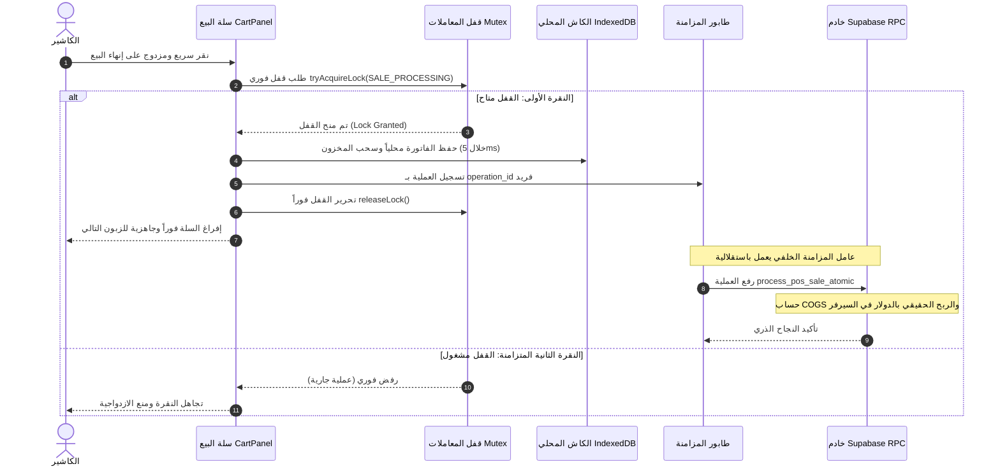

# وثيقة التدقيق الأمني والمالي الشامل وخطة الإصلاح الهندسية المحصنة
> **Architecture Specification: Comprehensive Security & Financial Logic Audit (Hardened EGM Spec)**

*   **المؤلف (Author):** almhtrf111312
*   **الحالة (Status):** مواصفة معمارية محصنة ومعتمدة للمرحلة الثانية (Stage 1 Approved - Ready for Implementation)
*   **تاريخ الاعتماد:** 2026-11-08
*   **تقرير المراجعة الموحد:** [`docs/designs/consolidated_review_report.md`](./consolidated_review_report.md)

--------------------------------------------------------------------------------

## 1. نظرة عامة (Overview)

تحدد هذه المواصفة المعمارية خطة تدقيق أمني ومحاسبي صارمة ومحصنة هندسياً لنظام نقطة البيع والحسابات السحابية **FlowPOS Pro**. تم تنقيح وتحصين هذه الوثيقة وفق مخرجات مراجعة نموذج الفيل والسمكة الذهبية (EGM Swarm Review) بمشاركة 7 وكلاء متخصصين.

تهدف الخطة إلى معالجة الفجوات الأمنية، وتحصين مسار قفل التطبيق، وعزل بيانات التكلفة الحساسة عن الكاشير دون تلويث قاعدة البيانات المحلية، وترسيخ الثوابت المالية السبعة، ومنع تعارضات وتزاحم طابور المزامنة دون اتصال (Offline-First):

### أ. التحصين الأمني وسياسات RLS ومسار قفل التطبيق (Security & RLS Guard)
*   **عزل صلاحيات الكاشير والمالك**: منع كشف أسعار التكلفة وأرباح الفواتير لكاشير المتجر على مستوى واجهة العرض وقاعدة البيانات، مع تفويض حساب التكلفة والأرباح حصرياً لخادم Supabase في دالة `process_pos_sale_atomic`.
*   **إحكام مسار قفل الأمان المحلي (`use-app-lock.tsx`)**:
    *   التحول الجذري إلى مبدأ **الإغلاق عند الفشل (Fail-Closed)**: حظر الثغرة السابقة التي كانت تفتح القفل فوراً عند غياب أو مسح الـ Salt أو الـ Hash محلياً.
    *   استئصال خوارزمية التجزئة الاحتياطية الضعيفة (32-bit fallback hash)، وفرض معيار Web Crypto API الصارم بـ SHA-256 وملح تشفيري عشوائي فريد (16-byte Cryptographic Salt).
    *   تجميد لوحة الأرقام ضد هجمات التخمين لمدة 30 ثانية بعد 5 محاولات خاطئة.
    *   تطبيق خاصية `inert` على شجرة الـ DOM لمنع أي تفاعل خلفي أو وميض عند استعادة التطبيق من الخلفية عبر أحداث Capacitor.

### ب. الثوابت المالية السبعة ومحرك الدقة المحاسبية (The Seven Financial Invariants)
ترسخ هذه المواصفة حماية الثوابت المالية السبعة كخطوط حمراء غير قابلة للنقاش في الكود:
1.  **العملة الأساسية المطلقة هي الدولار ($USD)**: كافة العمليات، رؤوس الأموال، الأرباح، والديون تُحسب وتُخزن بالدولار؛ والعملات الأخرى هي واجهات تسعير وسداد تعتمد على لقطة الصرف اللحظية (`exchange_rate_snapshot`).
2.  **الضريبة ليست ربحاً**: استبعاد مبالغ الضرائب بنسبة 100% من صافي الأرباح، وحصص الشركاء، وكلفة البضاعة المباعة (Cost of Goods Sold - COGS).
3.  **حظر الحذف المالي التدميري**: لا يُسمح نهائياً بالحذف الفيزيائي (`Hard DELETE`) لأي فاتورة أو حركة مالية؛ بل يُعتمد الحذف المنطقي (`status = 'cancelled'`) مع توليد قيود تسوية وعكس ذرية للأرباح والمخزون عبر `revert_invoice_partner_profits_atomic`.
4.  **تعليق أرباح الديون الآجلة لحين السداد الفعلي**: أرباح الفواتير الآجلة تُسجل كأرباح معلقة (`pending_profit`)، ولا تتحول إلى أرباح مؤكدة (`confirmed_profit`) إلا بمقدار نسبة السداد الفعلي لكل قسط، مع تنفيذ حركة تسوية نهائية (Final Profit Sweep) تنقل كامل المتبقي عند سداد آخر سنت.
5.  **دقة الحسابات العشرية الموحدة بـ `round8`**: توحيد معالجة الفواصل العشرية باستخدام توابع `@/lib/money-engine` (`round8`, `preciseAdd`, `preciseSubtract`, `preciseMultiply`) لمنع تراكم الأخطاء الحسابية العائمة في جافاسكريبت.
6.  **ثبات التكلفة التاريخية للفواتير المصدرة**: التكلفة المسجلة في بنود الفاتورة لحظة البيع نهائية وغير قابلة للتعديل بأثر رجعي عند تغير تكاليف التوريدات اللاحقة للمنتج.
7.  **عزل الصناديق ومطابقة الورديات محاسبياً**: حركات النقدية اليومية مقيدة بوردية الصندوق (`cash_shifts`)، ويتم توثيق أي عجز أو فائض كحركات صندوق رسمية عبر `close_cash_shift_atomic`.

### ج. منع التزاحم وسلامة المزامنة غير المتصلة (Concurrency & Offline Sync)
*   **قفل المعاملات الفوري والسريع (`transaction-lock.ts`)**:
    *   إضافة نمط الرفض الفوري `tryAcquireLock(LOCK_RESOURCES.SALE_PROCESSING)` لردع النقرات المزدوجة السريعة على زر إنهاء البيع في [`CartPanel.tsx`](../../src/components/pos/CartPanel.tsx) فوراً دون وضع الطلبات في طابور انتظار مكرر.
    *   قصر مدة حيازة القفل على عملية الإيداع المحلي الفوري في IndexedDB (<10ms) لتحرير السلة للكاشير دون تعليقها عبر رحلة الشبكة السحابية الكاملة.
*   **سلسلة تبعيات طابور المزامنة لمنع إسقاط السندات (`sync-queue.ts`)**:
    *   ربط سندات سداد الديون (`debt_payment`) التابعة بفاتورة البيع الآجل الأصلية (`debt_sale_bundle`) عبر معرف التبعية `dependsOn`.
    *   في حال تعثر الفاتورة الأصلية لسبب شبكي مؤقت، يتم تعليق معالجة سند السداد التابع تلقائياً بدلاً من إرساله بمفرده ورفضه من السحابة كخطأ نهائي (`Debt not found`) وحذفه من الطابور.

---

### د. تعريف المصطلحات وأدوات النظام (Definitions & Acronyms)
*   **COGS (Cost of Goods Sold)**: تكلفة البضاعة المباعة، وتساوي مجموع كميات البنود المباعة مضروبة في متوسط تكلفتها المرجحة لحظة البيع.
*   **RPC (Remote Procedure Call)**: استدعاء الإجراءات المخزنة البرمجية والذرية المنفذة داخل قاعدة بيانات PostgreSQL / Supabase بأعلى درجات الموثوقية.
*   **Mutex (Mutual Exclusion)**: قفل برمجي للاستبعاد المتبادل يمنع تنفيذ عمليتين حساستين على نفس المورد في نفس اللحظة.
*   **PIN (Personal Identification Number)**: رمز المرور الرقمي الشخصي المستخدم لقفل واجهة التطبيق ضد المتطفلين.
*   **Dexie / `hyperpos_cache`**: طبقات التغليف والتخزين المحلي لقاعدة بيانات المتصفح IndexedDB التي تضمن عمل النظام دون اتصال بالإنترنت.
*   **Capacitor**: بيئة العمل الهجينة المستخدمة لتحزيم تطبيق الويب ليعمل كتطبيق أندرويد أصلي على أجهزة التابلت مع دعم أحداث دورة الحياة (`appStateChange`).
*   **WebView**: حاوية العرض المدمجة داخل نظام أندرويد التي تشغل واجهة تطبيق FlowPOS Pro.

--------------------------------------------------------------------------------

## 2. تشخيص المشكلة وحالتها الراهنة (The Problem)

### أ. مخاطر تسريب البيانات الأمنية وثغرات قفل التطبيق:
1.  **ثغرة التجاوز المفتوح للقفل (Fail-Open Vulnerability in `use-app-lock.tsx`)**:
    *   في السطور 196-200 من [`src/hooks/use-app-lock.tsx`](../../src/hooks/use-app-lock.tsx)، يحتوي الكود على مسار تساهلي خطير:
        ```typescript
        if (!salt || !storedHash) {
          setIsLocked(false);
          return true;
        }
        ```
        إذا قام مستخدم غير مصرح له بحذف مفاتيح `salt` أو `hash` من `localStorage` أو تفريغ بيانات الموقع، فإن التطبيق يفتح قفله فوراً ويعتبر العملية صحيحة!
2.  **خطر تلويث التخزين المحلي للكاشير وتدمير حسابات التكلفة السحابية**:
    *   اقتراح تصفير `cost_price = 0` و `bulk_cost_price = 0` داخل قاعدة البيانات المحلية الدائمة (`hyperpos_cache` في IndexedDB) يمثل خطراً تشغيلياً جسيماً:
        *   إذا سجل المالك دخوله على نفس التابلت ليلاً، فسيقرأ التكلفة كـ `$0` بسبب تلوث الكاش المحلي.
        *   إذا أرسل طابور المزامنة تحديثاً لمنتج من جهاز الكاشير، فسيتم إرسال التكلفة `$0` للسحابة، مما يدمر حسابات التكلفة والأرباح التاريخية للمتجر.
3.  **ضعف دالة التجزئة الاحتياطية وسهولة التخمين**:
    *   تتضمن السطور 58-65 في `use-app-lock.tsx` خوارزمية تجزئة بدائية ضعيفة (32-bit string hash) سهلة الكسر في حال تعطل Web Crypto.
    *   الـ PIN المكون من 4 أرقام له 10,000 احتمال فقط، وتجزئة SHA-256 الخاطفة تتيح كسرها ببرامج التخمين في بضع ميلي ثوانٍ ما لم تُعزز بالملح العشوائي القوي وفترات الحظر المشددة بخاصية `inert`.

### ب. مخاطر الدقة الرياضية وتوزيع الأرباح وحسابات المخزون:
1.  **تشوه WAC عند التوريد برصيد سالب (Inventory Deficit & Deficit True-Up)**:
    *   عندما يبيع الكاشير بالسالب بسبب عجز مؤقت في المخزون (مثلاً الرصيد الحالي $-2$ بتكلفة تقديرية \$5)، ثم يصل توريد جديد بـ 5 قطع بتكلفة فعلية \$10:
        *   اعتماد التكلفة الجديدة (\$10) على كامل الرصيد دون تسوية يؤدي إلى تشويه COGS؛ فالقطعتان اللتان بيعتا بالسالب تم استهلاكهما فعلياً من التوريد الجديد ذي التكلفة \$10، مما يتطلب تسوية الفارق المحاسبي.
2.  **احتباس كسور الأرباح المعلقة للديون (Residual Trapped Profits)**:
    *   عند سداد أقساط الدين على دفعات متعددة مقسومة بنسب مئوية عائمة، قد يتبقى جزء ضئيل من السنت (مثل \$0.00000001) في `pending_profit` بعد سداد آخر قسط، مما يحرم الشركاء من تصفية أرباحهم بالكامل ما لم يتم تنفيذ حركة تسوية نهائية (Final Profit Sweep) تُفرغ كامل المعلق عند الرصيد الصفري.
3.  **حساب أرباح الفواتير غير المتصلة في الواجهة**:
    *   يقوم مكون [`CartPanel.tsx`](../../src/components/pos/CartPanel.tsx#L718-L740) بحساب الأرباح محلياً وتمريرها في `offlineCashInvoice`. عند حجب الكلفة عن الكاشير، يجب ضمان ألا تسجل الواجهة أرباحاً مضللة تظهر للمستخدم أوفلاين كـ 100% من المبيعات.

### ج. تعارض المزامنة الأوفلاين وتزاحم المعاملات:
1.  **كارثة سقوط سندات سداد الديون (Terminal Drops in `sync-queue.ts`)**:
    *   إذا أجرى الكاشير عملية بيع آجل أوفلاين (`debt_sale_bundle`) وسدد العميل دفعة تابعة لها (`debt_payment`):
        *   عند عودة الاتصال، إذا واجهت الفاتورة الأصلية تعثراً شبكياً مؤقتاً (503)، تنتقل حلقة المعالجة للسند التابع.
        *   ترفض السحابة السند لعدم وجود الفاتورة (`Debt not found`).
        *   تصنف دالة `isTerminalSyncError` الخطأ كخطأ نهائي، فيتم إسقاط السند نهائياً وتضييع أموال العميل وحسابات الصندوق!
2.  **طابور انتظار الـ Mutex وتكرار الفواتير**:
    *   دالة [`acquireLock`](../../src/lib/transaction-lock.ts#L45-L90) الحالية تضع الطلبات المتزامنة في طابور انتظار بدلاً من رفضها. إذا نقر الكاشير مرتين بسرعة، تُنفذ النقرة الأولى ثم تُنفذ الثانية فور تحرير القفل فتصدر فاتورة مكررة.

--------------------------------------------------------------------------------

## 3. الأهداف والمخرجات المعتمدة (Goals)

1.  **تحصين قفل التطبيق (App Lock Hardening)**:
    *   تطبيق نمط **Fail-Closed** الصارم في `use-app-lock.tsx` لمنع فتح التطبيق عند فقدان أو مسح بيانات التحقق.
    *   استئصال خوارزمية التجزئة الاحتياطية الضعيفة (السطور 58-65) والاعتماد الحصري على Web Crypto SHA-256 مع ملح عشوائي 16 بايت.
    *   تطبيق خاصية `inert` على شجرة واجهة المستخدم لمنع أي تفاعل خلفي أثناء القفل.
2.  **عزل التكلفة دون تلويث الكاش المحلي (Clean Cost Obfuscation)**:
    *   حظر كتابة أصفار في IndexedDB بشكل فيزيائي دائم.
    *   حجب حقول التكلفة في طبقة العرض الذاكرية (In-Memory ViewModel) لواجهة الكاشير عبر `omit(product, ['cost_price', 'bulk_cost_price'])`.
    *   تفويض حساب التكلفة والأرباح الحقيقية حصرياً للسحابة في `process_pos_sale_atomic`.
3.  **ترسيخ الدقة المحاسبية وتسوية أرباح الديون**:
    *   تطبيق حركة التسوية النهائية (Final Profit Sweep) لنقل 100% من الأرباح المعلقة المتبقية إلى المؤكدة فور سداد آخر قسط من الدين.
    *   توثيق معادلة تسوية عجز المخزون السابق (Deficit True-Up) عند التوريد برصيد سالب في دالة WAC السحابية.
4.  **منع المعاملات المزدوجة وإحكام طابور المزامنة**:
    *   تزويد `transaction-lock.ts` بآلية رفض فوري `tryAcquireLock` لردع النقرات السريعة المزدوجة على زر إنهاء البيع في `CartPanel.tsx`.
    *   قصر قفل المعاملات على الحفظ المحلي السريع (<10ms) لتحرير السلة للكاشير دون تأخير.
    *   إضافة خاصية التبعية `dependsOn` في `sync-queue.ts` لتعليق معالجة سندات الديون التابعة في حال تعثر الفاتورة الأصلية ومنع إسقاطها كأخطاء نهائية.

--------------------------------------------------------------------------------

## 4. ما هو خارج نطاق العمل (Non-Goals)

1.  **حظر تعديل الوحدات المجمدة (Frozen Modules)**:
    *   يُحظر منعاً باتاً فتح أو تعديل الملفات المحمية التالية:
        *   `src/pages/Warehouses.tsx`
        *   `src/pages/StockTransfer.tsx`
        *   `src/lib/cloud/warehouses-cloud.ts`
2.  **لا حذف فيزيائي مالي (No Hard Deletes)**:
    *   عدم كتابة أي أمر `DELETE FROM invoices` أو `DELETE FROM debts`؛ فالحذف المالي محظور هندسياً ومحاسبياً.
3.  **عدم تغيير العملة الأساسية للنظام**:
    *   يبقى الدولار الأمريكي ($USD) هو الأساس المحاسبي الوحيد المخزن في قاعدة البيانات، ولا يتم المساس بلقطة الصرف (`exchange_rate_snapshot`).
4.  **عدم تغيير مظهر أو تخطيط واجهة الكاشير**:
    *   الحفاظ التام على أزرار البيع وتجربة اللمس في `POS.tsx` و `CartPanel.tsx`.

--------------------------------------------------------------------------------

## 5. القرارات المعمارية المحسومة (Resolved Architectural Decisions)

تم حسم الأسئلة المفتوحة السابقة وتثبيتها كقرارات معمارية نهائية بعد مداولات مراجعة السمكة الذهبية:

*   **القرار الأول [محسوم - Resolved]**:
    *   *السؤال*: هل يتم حجب التكلفة عبر Views سحابية متعددة لكل دور أم عبر التطهير البرمجي؟
    *   *القرار المعتمد*: **الحجب الذاكري في طبقة العرض (In-Memory ViewModel Scrubbing)**؛ مع الإبقاء على كاش IndexedDB نزيهاً دون كتابة أصفار وهمية، وتفويض احتساب التكلفة والأرباح المعتمدة للسحابة في `process_pos_sale_atomic`.
*   **القرار الثاني [محسوم - Resolved]**:
    *   *السؤال*: كيف تُعالج الفواتير الآجلة وسندات سدادها غير المتصلة دون تعارض؟
    *   *القرار المعتمد*: **حزمة ذرية موحدة (`debt_sale_bundle`) وسلسلة تبعيات (`dependsOn`)**؛ الفاتورة وسدادها الأولي يُرسلان كحزمة ذرية برقم عملية واحد، وأي سندات سداد لاحقة تُعلق تلقائياً في الطابور إذا تعثرت الفاتورة الأصلية مؤقتاً لمنع إسقاطها.
*   **القرار الثالث [محسوم - Resolved]**:
    *   *السؤال*: ماذا يحدث عند فقدان بيانات التحقق من الـ PIN في `use-app-lock.tsx`؟
    *   *القرار المعتمد*: **الإغلاق التام عند الفشل (Fail-Closed)**؛ يُقفل التطبيق تماماً ويُمنع التجاوز، ويُطلب تسجيل الدخول بكلمة المرور السحابية الرئيسية لإعادة التعيين.

--------------------------------------------------------------------------------

## 6. رحلات المستخدم الحرجة المحصنة (Hardened Critical User Journeys - CUJs)

### رحلة المستخدم الحرجة الأولى (CUJ 1): إتمام فاتورة بيع مع حظر الازدواجية وحجب التكلفة
*   **المعطيات (Given)**:
    *   كاشير مسجل الدخول، وشاشة البيع [`POS.tsx`](../../src/pages/POS.tsx) تحتوي أصنافاً في السلة.
    *   بيانات التكلفة محجوبة عن ذاكرة العرض في المتصفح.
*   **الحدث (When)**:
    *   ينقر الكاشير نقراً مزدوجاً سريعاً ومتتالياً على زر "إنهاء البيع (نقد)".
*   **النتيجة المتوقعة (Then)**:
    *   النقرة الأولى تحوز القفل الفوري عبر `tryAcquireLock(LOCK_RESOURCES.SALE_PROCESSING)`، وتُحفظ الفاتورة محلياً في IndexedDB في أقل من 10 ميلي ثانية.
    *   النقرة الثانية المزدوجة تُرفض فوراً وتتجاهلها الواجهة دون تشكيل أي طابور أو إصدار فاتورة مكررة.
    *   تُفرغ السلة فوراً ويستأنف الكاشير خدمة العميل التالي، بينما يتولى عامل المزامنة الخلفي رفع الفاتورة بالمعرف الفريد `operation_id` واحتساب أرباحها سحابياً.

---

### رحلة المستخدم الحرجة الثانية (CUJ 2): توريد مخزون جديد مع تسوية عجز الرصيد السالب (Deficit True-Up)
*   **المعطيات (Given)**:
    *   صنف يعاني من عجز مخزني ناتج عن مبيعات سالبة (الرصيد: $-2$، تكلفة تقديرية \$5).
*   **الحدث (When)**:
    *   يقوم أمين المستودع بإدخال توريد جديد قدره 10 قطع بتكلفة فعلية \$10 للقطعة.
*   **النتيجة المتوقعة (Then)**:
    *   تنفذ دالة `receive_stock_wac` السحابية تسوية العجز (Deficit True-Up) للقطعتين السابقتين بتعديل تكلفة المبيعات، وتعتمد التكلفة الجديدة (\$10) على الرصيد الصافي الفائض (+8 قطع) برصيد إجمالي نهائي قدره 8 قطع بدقة `round8`.

---

### رحلة المستخدم الحرجة الثالثة (CUJ 3): سداد القسط الأخير وتصفية كامل الأرباح المعلقة (Final Profit Sweep)
*   **المعطيات (Given)**:
    *   فاتورة بيع آجل متبقٍ منها قسط أخير قدره \$10، ومسجل لها أرباح معلقة متبقية في `pending_profit` قدرها \$2.50000000.
*   **الحدث (When)**:
    *   يقوم العميل بسداد الـ \$10 المتبقية وتصفير الدين.
*   **النتيجة المتوقعة (Then)**:
    *   يتم استدعاء `confirm_partner_debt_profit_atomic`، وتتعرف الدالة على أن الدين أصبح صفراً (`remaining_debt == 0`).
    *   يتم تصفير `pending_profit` بنقل كامل الرصيد المتبقي (\$2.50) إلى `confirmed_profit` كحركة تسوية نهائية (Final Sweep Transaction) دون فقدان أي كسور عشرية.

---

### رحلة المستخدم الحرجة الرابعة (CUJ 4): استعادة التطبيق من الخلفية وتحدي رمز الـ PIN المشفر
*   **المعطيات (Given)**:
    *   ميزة قفل التطبيق مفعلة برمز PIN مشفر بملح عشوائي و SHA-256.
*   **الحدث (When)**:
    *   يقوم الكاشير بوضع التطبيق في الخلفية ثم استعادته، أو محاولة مسح `localStorage` لتجاوز القفل.
*   **النتيجة المتوقعة (Then)**:
    *   تستجيب أحداث Capacitor وتفرض شاشة `AppLockOverlay` مع تطبيق خاصية `inert` على الواجهة الخلفية لمنع أي نقرات متسللة.
    *   في حال فُقد الـ Salt أو الـ Hash، يرفض التطبيق الفتح فوراً (**Fail-Closed**) ويطالب بإدخال كلمة مرور الحساب السحابي الرئيسية لإعادة التهيئة.

--------------------------------------------------------------------------------

## 7. الخطة المعمارية والتقنية المحصنة (Hardened Technical Plan)

### المحور الأول: التحصين الأمني وقفل التطبيق وعزل التكلفة

#### 1. تحصين مسار قفل التطبيق `use-app-lock.tsx`:
*   **التحول إلى Fail-Closed**:
    *   تعديل السطور 196-200 ليصبح:
        ```typescript
        if (!salt || !storedHash) {
          console.warn('[AppLock] Security parameters missing. Failing closed.');
          setIsLocked(true);
          return false;
        }
        ```
*   **استئصال الـ Fallback الضعيف**:
    *   إزالة دالة التجزئة البسيطة في السطور 58-65، والاعتماد التام على `window.crypto.subtle.digest('SHA-256')`.
*   **حماية الواجهة بـ `inert`**:
    *   تطبيق خاصية `inert` على عنصر الجذر `#root` أثناء ظهور شاشة القفل لمنع وصول أحداث اللمس أو أدوات قارئ الشاشة للواجهة الخلفية.

#### 2. عزل أسعار التكلفة في طبقة العرض الذاكرية (In-Memory ViewModel Scrubbing):
*   في [`src/lib/cloud/products-cloud.ts`](../../src/lib/cloud/products-cloud.ts):
    *   داخل دالة جلب المنتجات السحابية [`loadProductsCloudInternal`](../../src/lib/cloud/products-cloud.ts#L459):
        *   تُحفظ المنتجات الأصلية كاملة في الكاش المحلي IndexedDB لضمان عدم تلويث قاعدة البيانات الدائمة على الأجهزة المشتركة.
        *   عند تزويد واجهة الكاشير بالبيانات في خطافات العرض، تُطبق دالة الإسقاط الذاكرية:
            ```typescript
            export const sanitizeProductForCashier = (product: Product): Product => {
              const { costPrice, bulkCostPrice, ...sanitized } = product;
              return sanitized as Product;
            };
            ```
*   تفويض حساب التكلفة والأرباح لسيرفر Supabase في `process_pos_sale_atomic` وعدم الاعتماد على أرباح العميل.

---

### المحور الثاني: المحرك المالي والدقة المحاسبية

#### 1. معادلة WAC وتسوية عجز المخزون السالب:
*   في دالة `receive_stock_wac`:
    *   إذا كان الرصيد السابق سالباً ($\text{Qty}_{\text{old}} < 0$):
        1. يتم تسوية تكلفة مبيعات العجز السابقة بفارق التكلفة الجديد:
           $$\text{COGS Adjustment} = |\text{Qty}_{\text{old}}| \times (\text{Cost}_{\text{new}} - \text{Cost}_{\text{old}})$$
        2. يُسجل قيد تسوية مخزني آلي لتصحيح أرباح المتجر.
        3. التكلفة الجديدة المعتمدة للرصيد الفائض الصافي تكون $\text{Cost}_{\text{new}}$.

#### 2. حركة التسوية النهائية لأرباح الديون (Final Profit Sweep):
*   في دالة `confirm_partner_debt_profit_atomic`:
    *   إذا كان $\text{Remaining Debt} = 0$:
        *   نقل كامل الرصيد المتبقي في `pending_profit` إلى `confirmed_profit` مباشرة دون ضرب النسب.

---

### المحور الثالث: منع التزاحم وسلامة المزامنة غير المتصلة

#### 1. القفل الفوري غير الانتظاري `tryAcquireLock`:
*   في [`src/lib/transaction-lock.ts`](../../src/lib/transaction-lock.ts):
    *   إضافة دالة حيازة فورية الرفض:
        ```typescript
        export const tryAcquireLock = (resource: string): LockResult => {
          if (isLocked(resource)) {
            return { acquired: false, error: 'عملية جارية بالفعل، يرجى الانتظار' };
          }
          return acquireLockSync(resource);
        };
        ```
    *   في [`CartPanel.tsx`](../../src/components/pos/CartPanel.tsx): استدعاء `tryAcquireLock(LOCK_RESOURCES.SALE_PROCESSING)` عند النقر على الدفع، وحفظ الفاتورة محلياً، ثم تحرير القفل فوراً في أقل من 10 ميلي ثانية.

#### 2. سلسلة تبعيات طابور المزامنة `sync-queue.ts`:
*   إضافة حقل `dependsOn?: string` في بنية `QueuedOperation`.
*   في معالج الطابور `processQueue`:
    *   إذا فشلت العملية الأب (`debt_sale_bundle`)، يتم تخطي العمليات التابعة لها (`dependsOn == parentId`) مؤقتاً دون زيادة عداد الفشل ودون إسقاطها.

---

### مخطط تدفق العمليات المحصن (Hardened Mermaid Sequence Diagram)



--------------------------------------------------------------------------------

## 8. الخيارات والبدائل التقنية المدروسة (Alternatives Considered)

### أ. البديل الأول: تصفية التكلفة بكتابة أصفار في IndexedDB محلياً
*   **سبب الرفض القاطع**: تلويث التخزين المحلي للأجهزة المشتركة بين المالك والكاشير، وخطر رفع أصفار للسحابة وتدمير أرباح المتجر المحاسبية و COGS.
*   **القرار المعتمد**: حظر كتابة أصفار في IndexedDB، وتطبيق الحجب في الذاكرة الحية (In-Memory ViewModel) لواجهة الكاشير، مع الاعتماد التام على السيرفر في احتساب التكلفة.

### ب. البديل الثاني: اصطفاف طلبات البيع في طابور انتظار للـ Mutex
*   **سبب الرفض القاطع**: اصطفاف الطلبات عند النقر المزدوج السريع يؤدي لإنشاء فاتورة ثانية مكررة فور انتهاء الأولى.
*   **القرار المعتمد**: دعم القفل الفوري الرفض (`tryAcquireLock`) لرفض أي نقرة متزامنة فوراً دون اصطفاف.

### ج. البديل الثالث: الحذف المالي التدميري
*   **سبب الرفض القاطع**: تدمير السجل الجنائي وتشويه تقارير الضرائب والورديات.
*   **القرار المعتمد**: الحذف المنطقي (`status = 'cancelled'`) وتوليد قيود عكسية ذرية عبر `revert_invoice_partner_profits_atomic`.

--------------------------------------------------------------------------------

## 9. خطة التنفيذ الجراحية وتحديد الملفات (Hardened Implementation Plan)

### أ. حزمة الملفات المستهدفة بالتعديل الجراحي:

1.  **[`src/hooks/use-app-lock.tsx`](../../src/hooks/use-app-lock.tsx)**:
    *   تعديل السطور 196-200 لفرض مبدأ **Fail-Closed** ومنع الفتح عند غياب بيانات التشفير.
    *   استئصال خوارزمية التجزئة الاحتياطية الضعيفة في السطور 58-65.
    *   إضافة خاصية `inert` للواجهة الخلفية عند تفعيل شاشة القفل.

2.  **[`src/lib/cloud/products-cloud.ts`](../../src/lib/cloud/products-cloud.ts)**:
    *   تصحيح مسار الاستدعاء: استهداف الدالة الداخلية [`loadProductsCloudInternal`](../../src/lib/cloud/products-cloud.ts#L459) ودالة التحويل [`toProduct`](../../src/lib/cloud/products-cloud.ts#L106).
    *   تطبيق دالة الإسقاط الذاكري `sanitizeProductForCashier` لعرض الكاشير دون لمس الكاش الفيزيائي في `saveToLocalCache`.

3.  **[`src/lib/transaction-lock.ts`](../../src/lib/transaction-lock.ts)**:
    *   إضافة دالة `tryAcquireLock(resource: string): LockResult` للرفض الفوري دون انتظار.
    *   استخدام الثابت القائم `LOCK_RESOURCES.SALE_PROCESSING`.

4.  **[`src/components/pos/CartPanel.tsx`](../../src/components/pos/CartPanel.tsx)**:
    *   حماية معالج إنهاء البيع `handleProcessSale` بـ `tryAcquireLock(LOCK_RESOURCES.SALE_PROCESSING)`.
    *   تحرير القفل فور إتمام الحفظ المحلي في IndexedDB دون انتظار السحابة.

5.  **[`src/lib/sync-queue.ts`](../../src/lib/sync-queue.ts)**:
    *   إضافة دعم التبعيات `dependsOn` في `QueuedOperation`.
    *   تعليق معالجة سندات الديون التابعة فور تعثر الفاتورة الأصلية لمنع إسقاطها كأخطاء نهائية.

---

### ب. الوحدات المجمدة المحظور المساس بها (Strictly Frozen Modules):
*   `src/pages/Warehouses.tsx` (ممنوع التعديل منعاً باتاً).
*   `src/pages/StockTransfer.tsx` (ممنوع التعديل منعاً باتاً).
*   `src/lib/cloud/warehouses-cloud.ts` (ممنوع التعديل منعاً باتاً).

--------------------------------------------------------------------------------

## 10. استراتيجية الاختبار والتحقق الشاملة (Testing & Verification Strategy)

1.  **اختبارات التحصين الأمني**:
    *   اختبار ثغرة Fail-Closed: مسح مفاتيح `localStorage` عمداً والتأكد من بقاء التطبيق مقفلاً وطلب كلمة المرور السحابية.
    *   اختبار سلامة الكاش: فحص IndexedDB والتأكد من عدم وجود قيم `0` مخزنة في حقول التكلفة لحسابات الكاشير.
2.  **اختبارات منع التزاحم والمزامنة**:
    *   محاكاة 10 نقرات متزامنة سريعة والتأكد من إنشاء فاتورة واحدة فقط ورفض الباقي بقفل `tryAcquireLock`.
    *   محاكاة تعثر شبكي لفاتورة دين أوفلاين والتأكد من تعليق سند السداد التابع وعدم إسقاطه من الطابور.
3.  **اختبارات الدقة المحاسبية**:
    *   التحقق من سداد آخر قسط للدين ونقل كامل `pending_profit` إلى `confirmed_profit` عبر Final Profit Sweep.
    *   التحقق من معادلة WAC وتسوية العجز بنجاح عند التوريد برصيد سالب.
4.  **بوابة البناء والتجميع**:
    *   تشغيل `npm run build` والتحقق من انتهاء عملية التجميع بخروج نظيف (Exit code 0).

--------------------------------------------------------------------------------

## 11. خطة التراجع وإدارة المخاطر (Rollback & Risk Mitigation)

| الخطر المحتمل | مستوى الخطر | الإجراء الوقائي واستراتيجية التراجع |
| :--- | :---: | :--- |
| إقفال غير مقصود للمستخدمين الحاليين بسبب Fail-Closed | منخفض | توفير مسار استرداد فوري عبر تسجيل الدخول بكلمة المرور السحابية المعتمدة لحساب المتجر. |
| تعليق سلة البيع في حال حدوث استثناء محلي | منخفض | تحرير قفل الـ Mutex حتماً داخل كتلة `finally` مع مهلة أمان قصوى 10 ثوانٍ. |
| تعثر سداد الديون غير المتصلة | منخفض | آلية التبعيات `dependsOn` تضمن معالجة متسلسلة واستعادة تلقائية فور عودة الاتصال. |
| حدوث خطأ غير متوقع أثناء التعديل | منخفض | التعديل محصور جراحياً في 5 ملفات مع إمكانية التراجع الفوري عبر Git (`git checkout .`). |

--------------------------------------------------------------------------------


## 12. تقرير مطابقة البيئة الحية وحزمة الإصلاحات الجذرية المعتمدة (Live Environment Reconciliation & Root-Cause Remediation)

بناءً على التدقيق الاستقصائي الشامل لقاعدة البيانات الحية وسجلات الأخطاء، تم رصد الأسباب الجذرية الدقيقة لتعثر بعض الإصلاحات السابقة واعتماد الحزمة التصحيحية الشاملة التالية:

### أ. تحليل أسباب فشل تطبيق حزم الهجرة السابقة (Root Cause of Migration Failure)
*   **خطأ تضارب تواقيع الدوال (`ERROR 42P13: cannot change return type of existing function`)**:
    *   رفض خادم PostgreSQL تطبيق ملفات الهجرة لتغير نوع الإرجاع (Return Type) للدوال الموجودة دون إسقاطها أولاً.
    *   **الحل الجذري**: إضافة أوامر صريحة لجميع الدوال المعنية بصيغة:
        `DROP FUNCTION IF EXISTS public.<fn_name>(<signature>);` بكافة التواقيع التاريخية لضمان قبول وتطبيق الهجرة فوراً وبدون أي أخطاء.

### ب. الإصلاحات الجذرية المنفذة في المراحل الست:
1.  **المرحلة 1: إيقاف العكس المزدوج لأرباح الشركاء (P0-4 Remediation)**:
    *   **الملف**: [`src/lib/cloud/invoices-cloud.ts`](file:///src/lib/cloud/invoices-cloud.ts)
    *   **الإجراء**: إزالة الاستدعاءات المكررة لـ `revertProfitDistributionCloud` داخل دالتي `refundInvoiceCloud` و `refundInvoicePartialCloud`؛ نظراً لأن دوال الخادم الذرية (`refund_invoice_atomic` و `refund_invoice_partial_atomic`) تقوم بالفعل بعكس أرباح الشركاء ذرياً بنسبة 100% داخل المعاملة. استدعاؤها من العميل كان يؤدي لخصم الأرباح مرتين متتاليتين من رصيد الشريك.
2.  **المرحلة 2: تصحيح استرداد الكرتونة والمخزون في `refund_invoice_atomic` (P1-5 Remediation)**:
    *   **الملف**: [`supabase/migrations/20261108160000_comprehensive_financial_and_security_remediation.sql`](file:///supabase/migrations/20261108160000_comprehensive_financial_and_security_remediation.sql)
    *   **الإجراء**: تصحيح استرداد صنف الكرتونة بضرب الكمية المستردة في معامل التحويل `conversion_factor` عندما تكون `unit = 'bulk'`. في السابق كانت تعيد فقط الكمية الاسمية مما يتسبب في فقدان 23 قطعة لكل كرتونة مستردة ذات معامل 24. كما تم تأكيد تنفيذ عكس أرباح الشركاء بنسبة 100% بالسيرفر.
3.  **المرحلة 3: ضبط نسبة سداد الديون ومنع نزيف الأرباح في `record_debt_payment_atomic` (P0-5 Remediation)**:
    *   **الملف**: [`supabase/migrations/20261108160000_comprehensive_financial_and_security_remediation.sql`](file:///supabase/migrations/20261108160000_comprehensive_financial_and_security_remediation.sql)
    *   **الإجراء**: حساب نسبة السداد الفعلي من المتبقي `v_installment_ratio = LEAST(1.0, round(v_amount / v_prev_remaining, 6))`، وحظر قلب `isDebt: false` لكامل سجل الأرباح إلا في حالة السداد التام 100% (`v_new_remaining <= 0`). وفي الدفعات الجزئية يتم تسجيل قيد منفصل لتحرير دفعة الربح (`تحرير دفعة دين`) دون العبث بسجل أصل الفاتورة، مما منع تحول أرصدة الشركاء إلى السالب عند الاسترداد.
4.  **المرحلة 4: تصحيح استعلام تكلفة البضاعة المباعة في `close_accounting_period_atomic` (P1-25 Remediation)**:
    *   **الملف**: [`supabase/migrations/20261108160000_comprehensive_financial_and_security_remediation.sql`](file:///supabase/migrations/20261108160000_comprehensive_financial_and_security_remediation.sql)
    *   **الإجراء**: احتساب تكلفة البضاعة المباعة (COGS) مباشرة بالربط مع `invoice_items` (`SUM(cost_price * quantity)`) بدلاً من محاولة قراءة عمود `total_cost` غير الموجود في جدول `invoices`، مما يمنع انهيار الدالة ويضمن دقة ميزان الإقفال المالي.
5.  **المرحلة 5: دالة خادم ذرية لحذف/عكس المصروف `delete_expense_atomic` (P1-23 Remediation)**:
    *   **الملفات**: [`supabase/migrations/20261108160000_comprehensive_financial_and_security_remediation.sql`](file:///supabase/migrations/20261108160000_comprehensive_financial_and_security_remediation.sql) و [`src/lib/cloud/expenses-cloud.ts`](file:///src/lib/cloud/expenses-cloud.ts)
    *   **الإجراء**: استبدال التعديلات الذاكرية غير الآمنة من المتصفح بدالة خادم مؤمنة بقفل `FOR UPDATE` تقوم بإعادة المبالغ المستقطعة لأرصدة الشركاء وتوسم المصروف بـ `is_reversed = true` دون حذفه تدميرياً مع توفير Fallback آمن وحماية وضع عدم الاتصال (Offline-first).
6.  **المرحلة 6: تنظيف الديون الوهمية وإعادة احتساب أرصدة العملاء (Data Backfill)**:
    *   **الإجراء**: إطلاق استعلام تصحيحي يحذف الديون الوهمية الناتجة عن فواتير نقدية (`payment_type = 'cash'`) ويعيد احتساب `customers.total_debt` بناءً على الديون الفعلية غير المسددة فقط.

--------------------------------------------------------------------------------
