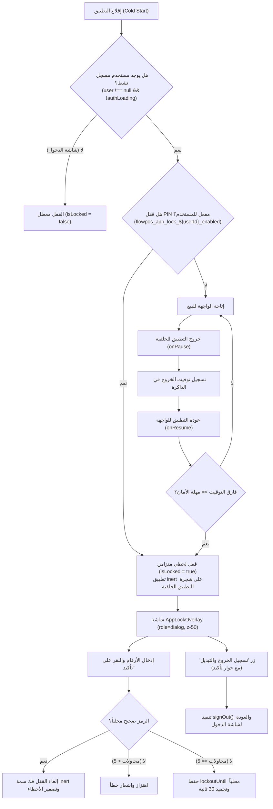

# وثيقة التصميم المعماري: حارس قفل الأمان وضبط حركية انتقال الثيم
# Architecture Design: Security Lock Enforcement and Theme Transition Dynamics

*   **المؤلف (Author):** almhtrf111312
*   **الحالة (Status):** معتمدة للمواصفات (Approved Specification)
*   **تاريخ الاعتماد:** 2026-11-08

--------------------------------------------------------------------------------

## 1. نظرة عامة (Overview)

تحدد هذه المواصفة المعمارية حلاً متكاملاً ومختبراً نقدياً لمعالجة عطل قفل الأمان وتعديل فيزياء انتقال الثيم في تطبيق FlowPOS Pro:

1.  **حارس قفل أمان التطبيق (App Security Lock Guard)**:
    بناء آلة حالة وموفر سياق مركزي (`AppLockProvider`) وطبقة حجب عائمة عليا (`AppLockOverlay`) تعتمد على استهلاك أحداث دورة الحياة (`useAppLifecycle`) لفرض القفل عند الإقلاع الأولي (Cold Start) أو عند العودة من الخلفية بعد انقضاء مهلة الأمان، مع الحفاظ الكامل على سلة المبيعات المفتوحة وحركات الكاشير اللحظية دون إعادة توجيه المسار أو فقدان البيانات في الذاكرة، والتحقق محلياً دون انتظار للشبكة (Zero Network Latency).
2.  **معايرة حركية فقاعة الثيم (Theme Bubble Transition Dynamics)**:
    ضبط معاملات الانتقال في [`theme-transition.ts`](../../src/lib/theme-transition.ts) لتعمل بمدة متزنة (550 ملي ثانية) ومنحنى تباطؤ فيزيائي `cubic-bezier(0.2, 0.9, 0.3, 1.0)` لتوفير استجابة بصرية مريحة للعين وتفادي الوميض المفاجئ.

--------------------------------------------------------------------------------

## 2. تشخيص المشكلة وحالتها الراهنة (The Problem)

### أ. عطل حارس قفل الأمان وتحديات البيئة المشتركة:
*   **غياب الفحص عند الإقلاع والاستئناف**: يدعم الملف الشخصي تعيين رمز PIN من 4 إلى 8 أرقام، لكن شجرة التطبيق في `App.tsx` و `ProtectedRoute.tsx` تفتقر لحارس يفحص تفعيل القفل، مما يتيح الوصول المباشر لكافة الشاشات.
*   **فقدان حالة الكاشير عند إعادة التوجيه (Destructive Redirect)**: تحويل المستخدم إلى `/login` يؤدي لتفريغ حالة React في الذاكرة ومسح سلة المبيعات المفتوحة والأصناف الممسوحة بالباركود.
*   **مسح المفاتيح التلقائي في `use-auth.tsx`**: تقوم دالة `clearAllUserSessionCaches` بمسح أي مفتاح يبدأ بـ `flowpos_` عند الدخول أو الخروج ما لم يكن مدرجاً صراحة في القائمة البيضاء (Whitelist).
*   **تسريب المدخلات عبر قارئات الباركود**: الاكتفاء بطبقة `z-index` معتمة لا يمنع أجهزة الباركود وأزرار `Tab` من إرسال أحداث `keydown` وتعديل سلة المبيعات خلف القفل.
*   **تداخل حسابات الكاشير على الجهاز الواحد**: استخدام مفاتيح تخزين عامة يخلط إعدادات الكاشير والمدير عند تبديل المستخدمين على نفس التابلت.

### ب. سرعة تأثير فقاعة الثيم:
*   تعمل الدالة الحالية بمدة سريعة جداً (400ms) ومنحنى حاد يسبب وميضاً مفاجئاً على شاشات الهواتف الكبيرة.

--------------------------------------------------------------------------------

## 3. الأهداف والمخرجات المعتمدة (Goals)

1.  **فرض الأمان الصارم (Strict Security Enforcement)**:
    *   قفل التطبيق لحظياً عند الإقلاع الأولي إذا كان القفل مفعلاً ومسجلاً للمستخدم الحالي (`user !== null`).
    *   قفل التطبيق تلقائياً عند العودة من الخلفية إذا تجاوزت مدة الغياب مهلة الأمان المحددة (فوري، 1 دقيقة، 5 دقائق).
2.  **حفظ سلة الكاشير دون إعادة توجيه (State Preservation)**:
    *   عرض شاشة القفل كطبقة عائمة عليا (`AppLockOverlay`) فوق الواجهة مع عزل الواجهة الخلفية عبر السمة القياسية `inert` و `aria-hidden="true"`، لمنع تسريب مدخلات قارئ الباركود أو التبويب دون مسح سلة البيع في الذاكرة.
3.  **التحقق المحلي المستقل (Offline Verification)**:
    *   تشفير محلي للرمز باستخدام `window.crypto.subtle` (SHA-256 مع Salt عشوائي 16 بايت فريد لكل مستخدم وجهاز)، يتيح التحقق محلياً دون أي زمن انتظار للشبكة (Zero Network Latency) وبمعالجة لحظية (< 5ms).
4.  **منع التحايل على حظر التخمين (Durable Rate Limiting)**:
    *   تجميد لوحة الأرقام 30 ثانية بعد 5 محاولات خاطئة، مع حفظ توقيت انتهاء الحظر `lockoutUntil` في `localStorage` لضمان عدم تخطيه بإعادة تشغيل التطبيق.
5.  **حماية مفاتيح القفل من الحذف التلقائي**:
    *   استثناء بادئة `flowpos_app_lock_` صراحة في `clearAllUserSessionCaches` داخل [`use-auth.tsx`](../../src/hooks/use-auth.tsx).
6.  **انسيابية حركية الثيم**:
    *   ضبط مدة الانتقال إلى 550ms ومنحنى `cubic-bezier(0.2, 0.9, 0.3, 1.0)`.

--------------------------------------------------------------------------------

## 4. ما هو خارج نطاق العمل (Non-Goals)

1.  **عدم المساس بالمعادلات المالية أو المحاسبية**: لا تعديل على حسابات الضرائب، الأرباح، الديون، أو جداول قاعدة البيانات المالية.
2.  **عدم لمس الوحدات المجمدة (Frozen Modules)**: ملفات المخازن والمناقلات تظل مجمدة ومحمية تماماً.
3.  **عدم تعديل خطاف البنية التحتية `use-app-lifecycle.tsx`**: يبقى الملف دون أي تعديل (0 Diffs) ويستهلك فقط عبر ردود النداء المتاحة.
4.  **عدم إضافة أحداث مكررة في `events.ts`**: الاعتماد الحصري على React Context لإدارة وتوزيع الحالة.

--------------------------------------------------------------------------------

## 5. رحلات المستخدم الحرجة (Critical User Journeys)

### الرحلة 1: عودة الكاشير للتطبيق بعد وضعه في الخلفية
*   **Given (المعطيات)**: الكاشير سجل دخوله بنجاح ولديه سلة بيع مفتوحة بها 3 أصناف، وقفل التطبيق مفعل بخيار "قفل فوري".
*   **When (الحدث)**: يخرج الكاشير للرد على تطبيق واتساب أو يقفل شاشة الهاتف لمدة 20 ثانية ثم يعود للتطبيق.
*   **Then (النتيجة)**: تظهر شاشة `AppLockOverlay` كطبقة عائمة معتمة تعزل الواجهة الخلفية عبر `inert`. يظل محتوى السلة محفوظاً، وبعد إدخال رمز PIN والنقر على زر "تأكيد"، تفتح الشاشة فوراً دون إعادة تحميل.

### الرحلة 2: محاولة التخمين وإعادة تشغيل التطبيق
*   **Given (المعطيات)**: شخص غير مصرح له يحاول تخمين رمز PIN على شاشة القفل.
*   **When (الحدث)**: يُدخل 5 محاولات خاطئة متتالية، فيتم تجميد الشاشة لمدة 30 ثانية، ثم يغلق التطبيق قسرياً من شاشة التطبيقات الحديثة ويعيد تشغيله.
*   **Then (النتيجة)**: عند إعادة التشغيل، يقرأ النظام طابع `lockoutUntil` من التخزين المحلي، وتظل لوحة الأرقام مجمدة مع إظهار العداد التنازلي لما تبقى من الـ 30 ثانية.

### الرحلة 3: النقر على زر الرجوع في أندرويد
*   **Given (المعطيات)**: شاشة القفل معروضة فوق الواجهة ومقفلة.
*   **When (الحدث)**: ينقر المستخدم على زر الرجوع العتادي في الهاتف.
*   **Then (النتيجة)**: بفضل سمة `role="dialog"` و `data-state="open"`، يمتنع `ExitConfirmDialog` عن تغيير المسارات خلف الشاشة، ويتم استدعاء `CapApp.exitApp()` للخروج الآمن من التطبيق دون كشف الواجهة.

--------------------------------------------------------------------------------

## 6. الخطة المعمارية والمواصفات التقنية (Technical Architecture)

### أولاً: مخطط تدفق آلة الحالة المتزامنة



### ثانياً: واجهة موفر السياق البرمجية (`AppLockContextType`)

```typescript
export interface AppLockConfig {
  enabled: boolean;
  timeoutSeconds: number; // 0 = فوري، 60 = 1 دقيقة، 300 = 5 دقائق
}

export interface AppLockContextType {
  isLocked: boolean;
  isLockEnabled: boolean;
  lockTimeout: number;
  failedAttempts: number;
  lockoutRemainingSeconds: number;
  isLockedOut: boolean;
  lockApp: () => void;
  unlockApp: (pin: string) => Promise<boolean>;
  setLockConfig: (config: AppLockConfig) => Promise<void>;
  updatePin: (newPin: string) => Promise<void>;
}
```

### ثالثاً: مفاتيح التخزين المنسوبة للمستخدم (Scoped Storage Keys)

تخزن كافة الإعدادات والهاشات منسوبة لمعرف المستخدم `userId` لمنع تداخل الحسابات المشتركة:
*   `flowpos_app_lock_${userId}_enabled`: `boolean`
*   `flowpos_app_lock_${userId}_timeout`: `number` (افتراضي 0 ثانية)
*   `flowpos_app_lock_${userId}_salt`: `string` (سلسلة Hex لـ 16 بايت عشوائية)
*   `flowpos_app_lock_${userId}_hash`: `string` (تشفير SHA-256 بصيغة Hex لـ `salt + pin`)
*   `flowpos_app_lock_${userId}_lockout_until`: `number` (طابع زمني بالملي ثانية)

### رابعاً: عزل الإدخال ومنع وميض الشاشة (DOM Isolation & Zero Flash)
1.  **التهيئة المتزامنة (Zero Flash)**:
    يتم احتساب القفل في الحالة الابتدائية لـ `useState` فورياً قبل رسم أي إطار:
    ```typescript
    const [isLocked, setIsLocked] = useState<boolean>(() => {
      if (!user) return false;
      return localStorage.getItem(`flowpos_app_lock_${user.id}_enabled`) === 'true';
    });
    ```
2.  **عزل الخلفية القياسي (`inert`)**:
    عندما يكون `isLocked === true`، يتم تطبيق سمة `inert` و `aria-hidden="true"` على حاوية شجرة التطبيق الأساسية `#app-main-layout`، مما يمنع التركيز، وأحداث لوحة المفاتيح، وقارئات الباركود الخارجية من الوصول للسلة دون التأثير على بيانات الذاكرة.

--------------------------------------------------------------------------------

## 7. المخاطر والمعالجات والحدود (Risks & Mitigations)

| الخطر المحتمل | مستوى الأثر | المعالجة الهندسية المعتمدة في التصميم |
| :--- | :---: | :--- |
| مسح مفاتيح القفل عند تسجيل الخروج أو الدخول | عالي | استثناء بادئة `flowpos_app_lock_` صراحة في `clearAllUserSessionCaches` داخل [`use-auth.tsx`](../../src/hooks/use-auth.tsx). |
| تلاعب أو مسح مفتاح التفعيل محلياً من المتصفح | متوسط | اشتراط وجود هاش صالح؛ في حال تلف الهاش أو فقدانه، يُطلب من المستخدم تسجيل الدخول بكلمة المرور الأصلية بدلاً من فتح القفل تلقائياً. |
| تصادم زر الرجوع في أندرويد مع `ExitConfirmDialog` | عالي | إضافة سمة `role="dialog"` و `data-state="open"` لمكون `AppLockOverlay`، وتنفيذ الخروج الآمن للتطبيق عند الضغط. |
| تجاوز حظر التخمين (Lockout) بإعادة تشغيل التطبيق | عالي | حفظ `lockoutUntil` كطابع زمني في `localStorage` ومقارنته مع توقيت الجهاز عند الإقلاع. |
| نسيان رمز PIN من قبل الكاشير | متوسط | توفير زر "تسجيل الخروج والتبديل" مع نافذة تأكيد تحذيرية لنقل المستخدم إلى شاشة الدخول الرئيسية بالبريد وكلمة المرور. |
| بطء أو انقطاع الإنترنت في المحل | عالي | التحقق مشتق محلياً بالكامل (Client-side Salted SHA-256)، ويعمل بنسبة 100% دون الحاجة لأي اتصال بالسحابة. |

--------------------------------------------------------------------------------

## 8. البدائل المدروسة وأسباب استبعادها (Alternatives Considered)

### البديل 1: إعادة التوجيه لصفحة تسجيل الدخول (`Navigate to /login`) عند القفل
*   **سبب الاستبعاد**: خرق لتجربة الكاشير وتفريغ سلة المبيعات المفتوحة والأصناف الممسوحة بالباركود من ذاكرة التطبيق.

### البديل 2: التحقق الحصري من الرمز عبر السحابة (`supabase.rpc('verify_user_pin')`)
*   **سبب الاستبعاد**: خرق صريح لمبدأ التطبيق غير القابل للتفاوض (Offline-First POS Invariant) حيث يتعطل فتح القفل فور انقطاع الإنترنت عن المحل.

### البديل 3: تطبيق تشفير PBKDF2 بـ 100,000 دورة
*   **سبب الاستبعاد**: استهلاك مفرط للذاكرة والمعالج على أجهزة الكاشير وهواتف الأندرويد الاقتصادية (Quad-core Mali GPUs)، مما يسبب تجمداً للواجهة عند كل عملية فتح قفل، بينما الهدف هنا هو قفل شاشة سريع للكاشير تدعمه آلية حظر زمني محلي صارم.

### البديل 4: تعديل خطاف البنية التحتية `src/hooks/use-app-lifecycle.tsx`
*   **سبب الاستبعاد**: انتهاك مبدأ المسؤولية الواحدة وتلويث خطاف عام يخدم مستهلكين آخرين، حيث يمكن استهلاكه بكفاءة تامة من داخل `AppLockProvider` دون أي سطر تعديل (0 Diffs).

--------------------------------------------------------------------------------

## 9. خطة التنفيذ التفصيلية وملفات التعديل (Detailed Implementation Plan)

### 1. [`src/hooks/use-auth.tsx`](../../src/hooks/use-auth.tsx)
*   **نوع التعديل**: تعديل ملف قائم (Whitelisting).
*   **التفاصيل الإجرائية**:
    في دالة `clearAllUserSessionCaches` (السطر 225)، إضافة استثناء صريح لمنع مسح إعدادات وهاش قفل الأمان:
    ```typescript
    key !== 'flowpos_persistent_hardware_id' &&
    !key.startsWith('flowpos_app_lock_') // 👈 حماية إعدادات وهاش القفل من الحذف
    ```

### 2. `src/hooks/use-app-lock.tsx`
*   **نوع التعديل**: إنشاء ملف جديد.
*   **التفاصيل الإجرائية**:
    *   إنشاء موفر السياق `AppLockProvider` والخطاف `useAppLock`.
    *   استهلاك `useAppLifecycle` لضبط `onPause` (تسجيل توقيت الخروج) و `onResume` (مقارنة المهلة وتفعيل القفل).
    *   إدارة المفاتيح المنسوبة لمعرف المستخدم `flowpos_app_lock_${user.id}_*`.
    *   دالة التحقق المحلي عبر `window.crypto.subtle.digest('SHA-256', ...)`.
    *   إدارة حظر التخمين ومزامنة العداد التنازلي مع `localStorage`.

### 3. `src/components/auth/AppLockOverlay.tsx`
*   **نوع التعديل**: إنشاء ملف جديد.
*   **التفاصيل الإجرائية**:
    *   بناء واجهة القفل العائمة مع سمات `role="dialog"` و `data-state="open"` و `aria-modal="true"`.
    *   لوحة أرقام لمسية (أزرار 0–9، زر مسح، وزر "تأكيد / دخول" واضح لدعم الرموز المتغيرة من 4 إلى 8 أرقام).
    *   عداد تنازلي وتجميد للوحة الأرقام عند استمرار الحظر الزمني.
    *   زر خروج طارئ مع حوار تأكيد تحذيري ينفذ `signOut()` من `useAuth`.

### 4. [`src/App.tsx`](../../src/App.tsx)
*   **نوع التعديل**: تعديل ملف قائم.
*   **التفاصيل الإجرائية**:
    *   وضع `<AppLockProvider>` في شجرة الموفرات داخل `<AuthProvider>` وداخل `<HashRouter>`.
    *   إدراج `<AppLockOverlay />` وتطبيق سمة `inert={isLocked ? "" : undefined}` على حاوية الشاشة الرئيسية.
    *   اشتراط عدم ظهور القفل إلا إذا كان المستخدم مسجلاً (`user !== null && !authLoading`).

### 5. [`src/components/settings/ProfileManagement.tsx`](../../src/components/settings/ProfileManagement.tsx)
*   **نوع التعديل**: تعديل ملف قائم.
*   **التفاصيل الإجرائية**:
    *   إضافة مفتاح تبديل (Switch) لتفعيل قفل الأمان، وقائمة منسدلة لمهلة القفل (فوري، 1 دقيقة، 5 دقائق).
    *   توليد Salt و Hash محليين للمستخدم الحالي وحفظهما عند قيام المستخدم بتعيين أو تغيير رمز PIN، مع استدعاء `set_user_pin` السحابي كالمعتاد.

### 6. [`src/lib/theme-transition.ts`](../../src/lib/theme-transition.ts)
*   **نوع التعديل**: تعديل ملف قائم.
*   **التفاصيل الإجرائية**:
    *   تعديل مدة الانتقال من `400` إلى `550` ملي ثانية.
    *   تحديث منحنى الحركة إلى `cubic-bezier(0.2, 0.9, 0.3, 1.0)`.
    *   الحفاظ على استثناء `prefers-reduced-motion` الآمن للتطبيق الفوري بـ 0ms.


--------------------------------------------------------------------------------

## 10. المرحلة الثانية: التحقق اللحظي التلقائي (Auto-Submit PIN) والفتح بالبصمة (Biometric / WebAuthn Unlock)

استجابة لمتطلبات تجربة المستخدم المتقدمة والمطابقة لمعايير أنظمة التشغيل المصرفية والحديثة (iOS / Android Keyguard):

### أ. التحقق اللحظي التلقائي فور إكمال الرمز (Auto-Submit on Completion):
1. **طول الرمز النشط (`pinLength`)**: يتم حفظ وتتبع طول الرمز المدخل للمستخدم (الافتراضي 4 خانات، أو حسب ما تم ضبطه).
2. **الاستدعاء التلقائي اللحظي (0ms Latency)**:
   * عند الضغط على الرقم الأخير في `handleDigitPress`:
     ```typescript
     const nextPin = enteredPin + digit;
     setEnteredPin(nextPin);
     if (nextPin.length === pinLength) {
       void verifyAndUnlock(nextPin);
     }
     ```
   * **في حالة الرمز الصحيح**: يُفك القفل فورياً وتختفي الشاشة بسلاسة دون الحاجة لأي زر تأكيد.
   * **في حالة الرمز الخاطئ**:
     * تفعيل اهتزاز فوري للمؤشرات (`animation: 'lock-shake 0.4s ease-in-out'`).
     * إظهار رسالة خطأ صريحة باللون الأحمر: «كلمة المرور خاطئة».
     * مسح الأرقام المدخلة تلقائياً لتجهيز الحقل للمحاولة التالية فوراً دون الحاجة للضغط على مسح.
     * استمرار حظر المحاولات بعد 5 مرات متتالية (Rate Limiting 30s).

### ب. محرك الفتح بالمقاييس الحيوية والبصمة (`src/lib/biometric-auth.ts`):
1. **التوافق الهجين الشامل (Cross-Platform Hybrid Architecture)**:
   * **تطبيقات Capacitor الأصلية (Android / iOS)**: فحص توفر `BiometricAuth` وتشغيل نافذة البصمة الرسمية.
   * **المتصفحات / PWA / Electron / Desktop**: استخدام واجهة `window.PublicKeyCredential` (WebAuthn Platform Authenticator) المدمجة دون حزم خارجية، والتي تدعم مستشعرات البصمة وWindows Hello وTouch ID وFace ID.
2. **التدفق البصري والتلقائي (UX & Auto-Prompt)**:
   * **الفتح التلقائي (Auto-Prompt)**: عند قفل التطبيق ووجود البصمة مفعلة، يُفتح مستشعر البصمة تلقائياً بعد 350ms لتمكين الدخول الفوري بلمسة واحدة.
   * **زر البصمة في لوحة الأرقام**: ظهور أيقونة `Fingerprint` في اللوحة مع زر وصول سريع أسفلها.
   * **البديل الدائم**: إذا تم إلغاء البصمة أو فشلت، تظل لوحة أرقام PIN متاحة كبديل أساسي دائم.
3. **التحكم والإدارة من الإعدادات (`ProfileManagement.tsx`)**:
   * إضافة كبسولة تفعيل/تعطيل الفتح بالبصمة عند توفر المستشعر على الجهاز.

--------------------------------------------------------------------------------

## 11. المرحلة الثالثة: صرامة مسح الرمز، الارتباط الحتمي للبصمة، والتأكيد الثنائي للخروج (Build 461)

استجابة للتوجيهات الصارمة لإدارة الأمان وتجربة مستخدمي أجهزة نقاط البيع المشتركة:

### أ. سياسة المسح التام للرمز عند التعطيل (PIN & Biometric Purge on Disable):
1. بمجرد قيام المستخدم بتعطيل قفل الأمان في الإعدادات (`setLockConfig({ enabled: false })`)، يتم مسح التجزئة والملح وطول الرمز واعتماد البصمة بالكامل من التخزين المحلي:
   * مسح `flowpos_app_lock_${userId}_hash`
   * مسح `flowpos_app_lock_${userId}_salt`
   * مسح `flowpos_app_lock_${userId}_length`
   * مسح `flowpos_app_lock_${userId}_biometric_enabled`
   * مسح `flowpos_app_lock_${userId}_biometric_cred_id`
   * مسح `flowpos_app_lock_${userId}_lockout_until`
   * مسح `flowpos_app_lock_${userId}_session_unlocked`
2. **استحالة إعادة التفعيل التلقائي**: عند محاولة إعادة تفعيل مفتاح القفل، يتحقق النظام من عدم وجود أي رمز مخزن، فيقوم فوراً بفتح نافذة تعيين رمز PIN جديد، ولا يُفعّل القفل إلا بعد إتمام إنشاء الرمز وتشفيره.

### ب. الارتباط الحتمي للبصمة بقفل الأمان (Biometric Strict Coupling):
1. لا يمكن تفعيل أو تشغيل الفتح بالبصمة إذا كان قفل التطبيق معطلاً أو لا يوجد رمز PIN نشط.
2. تتبع البصمة دورة حياة القفل؛ فتعطيل قفل الأمان يؤدي فورياً إلى إغلاق ومسح إعدادات البصمة.

### ج. التأكيد الثنائي لتسجيل الخروج الطارئ (Double Confirmation Exit Modal):
1. لحماية الفواتير وسلال المبيعات المفتوحة في الذاكرة من الإلغاء العرضي، تم استبدال نافذة الخروج البسيطة بنظام تأكيد مرحلي صارم من خطوتين:
   * **الخطوة الأولى (استيضاح النية)**:
     * العنوان: «تأكيد تسجيل الخروج (خطوة 1 من 2)»
     * الوصف: استفسار عن رغبة المستخدم في الخروج والتبديل مع التذكير بالحاجة للبريد وكلمة المرور.
     * الأزرار: [إلغاء والعودة للقفل] / [نعم، متابعة للخطوة التالية].
   * **الخطوة الثانية (التحذير الحاسم النهائي)**:
     * العنوان: «تحذير نهائي وتأكيد جازم (خطوة 2 من 2)»
     * الوصف: تنبيه شديد الوضوح بأن سلة المبيعات الحالية في الذاكرة ستُفرغ تماماً وستنتهي جلسة الكاشير.
     * الأزرار: [تراجع وإلغاء الخروج] / [تأكيد تسجيل الخروج والتبديل الآن].
2. لا يتم استدعاء `signOut()` إلا بعد الضغط الصريح على زر التأكيد في الخطوة الثانية.

### د. ثبات أبعاد زر البصمة في اللوحة (Keypad Target Stability):
* الإبقاء على أبعاد وتصميم زر البصمة وزر المسح بنفس الحجم المتناسق لشبكة لوحة الأرقام (ارتفاع h-14 وزوايا rounded-2xl) لمنع أي تشوه بصري أو لمسي في أبعاد الكيباد.
